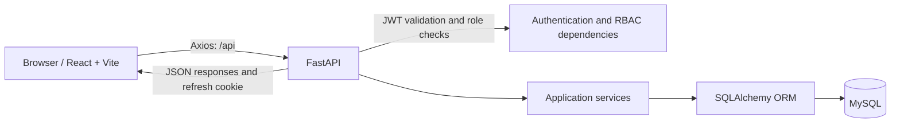

# SMS

SMS is a subscription-management application built for the Odoo hackathon preliminaries. It provides a foundation for managing a product catalogue and subscription plans with role-aware access, while keeping the customer-facing catalogue limited to products and plans that are currently available.

The project separates a React frontend from a FastAPI/MySQL backend. Its current goals are secure account access, clear role boundaries, maintainable product and plan data, and a professional interface for administration and catalogue viewing.

## Key features

Implemented today:

- Customer registration, sign-in, sign-out, refresh-token sessions, and password reset.
- Short-lived JWT access tokens held in browser memory and rotating `HttpOnly` refresh cookies.
- Server-enforced Admin, Staff, and Customer roles.
- Admin product creation, editing, activation, and deactivation.
- Admin subscription-plan creation, editing, activation, and deactivation.
- Normalized plan features stored independently from plans.
- Staff read-only access to products and plans.
- A customer catalogue that exposes only active products and active plans belonging to active products.
- Clear management UI treatment for plans made unavailable by an inactive parent product; this does not alter the plan's stored status.

The dashboard, quotations, subscriptions, invoices, payments, reports, discounts, taxes, customer management, profile, and billing workflows are not complete end-to-end modules. Some currently have static or placeholder frontend screens and should not be treated as implemented business functionality.

## Technology stack

| Area | Technology | Use in this project | Why this fit the project |
| --- | --- | --- | --- |
| Frontend | React 18 | Component-based screens, authentication context, and shared UI components. | Keeps the interactive management UI modular without introducing a different frontend framework. |
| Frontend | JavaScript (JSX) | All client source is JavaScript/JSX. | Matches the existing codebase and avoids a TypeScript migration. |
| Frontend | Vite | Development server and production bundle generation. | Provides the existing lightweight React build workflow. |
| Frontend | Tailwind CSS | Layout, spacing, responsive utilities, and visual styling. | Supports the existing responsive UI while keeping styling close to components. |
| Frontend | React Router | Client-side routes and role-guarded pages. | Provides the routing already used by the application. |
| Frontend | TanStack Query | Product, plan, and catalogue request caching and invalidation. | Keeps API state and post-mutation refreshes consistent. |
| Frontend | Axios | HTTP client, bearer-token injection, and refresh retry flow. | Centralizes API communication and session recovery. |
| Frontend | React Hook Form | Existing form handling for authentication and quotation UI. | Reduces form state boilerplate in the current React screens. |
| Frontend | Zod | Browser-side form validation. | Mirrors validation requirements before requests reach the API. |
| Backend | Python 3.11+ | FastAPI application, services, models, CLI, and tests. | Matches the backend runtime documented and used by the project. |
| Backend | FastAPI | REST API, dependency injection, OpenAPI documentation, and request handling. | Supplies typed request handling and built-in API documentation. |
| Backend | SQLAlchemy 2 | ORM models, database sessions, and queries. | Keeps MySQL persistence and relationships in Python models. |
| Backend | Pydantic 2 / pydantic-settings | Request/response validation and environment-based settings. | Validates API boundaries and keeps configuration outside source code. |
| Database | MySQL 8.0 | Development and test persistence. | The schema, migrations, and documented deployment target use MySQL. |
| Database | Alembic | Versioned MySQL schema migrations. | Tracks the existing auth and product/plan schema revisions. |
| Security | JWT | Short-lived bearer access tokens. | Allows the frontend to authorize API requests without persisting access tokens. |
| Security | Argon2id | Password hashing. | The configured password hasher uses Argon2id rather than storing plaintext passwords. |

## System architecture



- The React frontend renders the role-appropriate experience, keeps access tokens in memory, and sends authenticated requests through Axios.
- FastAPI exposes `/api` routes, validates inputs with Pydantic, and documents the API automatically.
- Authentication dependencies validate JWTs and reload the user from MySQL on protected requests; permissions are therefore checked against current database role/status data.
- Service modules hold authentication, product, and plan business logic. SQLAlchemy maps those operations to MySQL.
- MySQL stores users, hashed refresh/reset tokens, products, plans, and plan features. Alembic manages schema revisions.

## How the application works

1. A user opens the Vite-served React frontend.
2. A customer can register; any user can sign in through the FastAPI authentication API.
3. The backend verifies the Argon2id password hash and account status, returns a short-lived JWT access token, and sets a rotating `HttpOnly` refresh-token cookie.
4. The frontend keeps the access token in memory. Axios adds it to protected requests and attempts `/api/auth/refresh` when an eligible request receives `401`.
5. FastAPI decodes the access token, loads the current user, verifies active status, and applies the route's allowed roles.
6. Routes call services, which validate business rules and query or update MySQL through SQLAlchemy.
7. The API returns Pydantic-validated JSON to the frontend. Product/plan mutations invalidate TanStack Query caches so management and catalogue data refresh.

## Role-based workflow

| Role | Verified capabilities |
| --- | --- |
| Admin | Creates staff accounts; lists users; changes staff account status; creates, edits, activates, and deactivates products and subscription plans. |
| Staff | Can access the permitted management views and read products and plans. Product and plan write endpoints are rejected by the API. |
| Customer | Can register and use the customer catalogue. The API returns only active products and active plans whose parent products are active. |

Role visibility in the frontend is a convenience only. The FastAPI API remains the authority for authorization.

## Project directory structure

```text
Odoo-Prelims/
├── frontend/
│   ├── src/
│   │   ├── auth/                 # Client auth context, tokens, route guards
│   │   ├── pages/                # Authentication, catalogue, product, and plan pages
│   │   ├── api.js                # Axios client and API helpers
│   │   ├── components.jsx        # Shared shell and UI components
│   │   └── main.jsx              # React bootstrap
│   ├── .env.example              # Vite environment-variable example
│   ├── index.html
│   ├── package.json
│   ├── postcss.config.js
│   ├── tailwind.config.js
│   └── vite.config.js
├── backend/
│   ├── alembic/                  # Alembic environment and revisions
│   ├── app/
│   │   ├── api/                  # Routes and dependencies
│   │   ├── core/                 # Settings, security, password policy
│   │   ├── db/                   # Engine, sessions, declarative base
│   │   ├── models/               # SQLAlchemy models
│   │   ├── schemas/              # Pydantic schemas
│   │   ├── services/             # Business logic
│   │   └── main.py               # FastAPI application
│   ├── tests/                    # Backend pytest suite
│   ├── .env.example
│   ├── alembic.ini
│   └── requirements.txt
├── .gitignore
└── README.md
```

## Prerequisites

- Git
- Python 3.11 or newer
- Node.js and npm (use a current Node.js LTS release; no Node version is pinned in `package.json`)
- MySQL 8.0 running locally or otherwise reachable from the backend

## Installation and setup

### A. Clone the repository

```powershell
git clone https://github.com/joe2004l/Odoo-Prelims.git
cd Odoo-Prelims
```

### B. Configure MySQL and the backend

Create the development and test schemas and a dedicated application user with a MySQL administrator account. Replace the placeholder password before use.

```sql
CREATE DATABASE IF NOT EXISTS odoo_prelims
  CHARACTER SET utf8mb4 COLLATE utf8mb4_0900_ai_ci;

CREATE DATABASE IF NOT EXISTS odoo_prelims_test
  CHARACTER SET utf8mb4 COLLATE utf8mb4_0900_ai_ci;

CREATE USER IF NOT EXISTS 'odoo_prelims'@'localhost'
  IDENTIFIED BY 'use-a-strong-password';

GRANT ALL PRIVILEGES ON odoo_prelims.* TO 'odoo_prelims'@'localhost';
GRANT ALL PRIVILEGES ON odoo_prelims_test.* TO 'odoo_prelims'@'localhost';
FLUSH PRIVILEGES;
```

Set up and start the backend from a PowerShell terminal:

```powershell
cd .\backend
python -m venv .venv
.\.venv\Scripts\Activate.ps1
pip install -r requirements.txt
Copy-Item .env.example .env
```

Edit `backend/.env` with your local MySQL credentials and a strong random JWT secret. Then apply the tracked migrations and run the API:

```powershell
alembic upgrade head
python -m uvicorn app.main:app --reload
```

The backend listens on `http://localhost:8000` by default.

Optional bootstrap commands, from `backend/` with the virtual environment active:

```powershell
python -m app.cli check-db
python -m app.cli create-admin
```

### C. Configure and start the frontend

Open a second PowerShell terminal at the repository root:

```powershell
cd .\frontend
npm install
Copy-Item .env.example .env
npm run dev
```

The Vite development server normally runs at `http://localhost:5173`. The default frontend API URL is already `http://localhost:8000/api`; copying the frontend `.env.example` is optional unless you need a different API location.

## Environment variables

Do not commit `.env` files. The examples below are placeholders only.

### Frontend (`frontend/.env`)

| Variable | Purpose | Example |
| --- | --- | --- |
| `VITE_API_URL` | FastAPI API prefix used by Axios. | `http://localhost:8000/api` |

### Backend (`backend/.env`)

| Variable | Purpose | Example placeholder |
| --- | --- | --- |
| `APP_NAME` | API title. | `Subscription Management System API` |
| `APP_ENV` | Runtime environment. | `development` |
| `API_PREFIX` | Prefix for API routes. | `/api` |
| `LOG_LEVEL` | Application logging level. | `INFO` |
| `DATABASE_URL` | MySQL connection URL for development data. | `mysql+pymysql://odoo_prelims:<password>@127.0.0.1:3306/odoo_prelims?charset=utf8mb4` |
| `TEST_DATABASE_URL` | Separate MySQL URL used exclusively by tests. | `mysql+pymysql://odoo_prelims:<password>@127.0.0.1:3306/odoo_prelims_test?charset=utf8mb4` |
| `JWT_SECRET_KEY` | Strong secret for signing access tokens. | `<generate-a-long-random-secret>` |
| `JWT_ALGORITHM` | JWT signing algorithm. | `HS256` |
| `ACCESS_TOKEN_EXPIRE_MINUTES` | Access-token lifetime. | `15` |
| `REFRESH_TOKEN_EXPIRE_DAYS` | Refresh-cookie lifetime. | `7` |
| `PASSWORD_RESET_TOKEN_EXPIRE_MINUTES` | Password-reset token lifetime. | `30` |
| `FRONTEND_URL` | Base URL used in password-reset links. | `http://localhost:5173` |
| `CORS_ORIGINS` | Comma-separated browser origins allowed by CORS. | `http://localhost:5173` |
| `COOKIE_SECURE` | Require HTTPS for refresh cookies. Set `true` in production. | `false` |
| `COOKIE_SAMESITE` | Refresh-cookie same-site policy. | `lax` |
| `COOKIE_DOMAIN` | Optional cookie domain. | `<leave-unset-for-localhost>` |
| `SMTP_HOST` | SMTP server. Empty uses the development mail outbox. | `<smtp-host>` |
| `SMTP_PORT` | SMTP server port. | `587` |
| `SMTP_USERNAME` | SMTP username, if required. | `<smtp-user>` |
| `SMTP_PASSWORD` | SMTP password, if required. | `<smtp-password>` |
| `SMTP_FROM_EMAIL` | Sender address for reset mail. | `no-reply@example.com` |
| `SMTP_TLS` | Enable STARTTLS for SMTP. | `true` |
| `MAIL_DEV_DIR` | Relative/absolute local development mail outbox. | `var/mail` |
| `ADMIN_FULL_NAME` | Bootstrap-admin display name used by the CLI. | `System Administrator` |
| `ADMIN_EMAIL` | Bootstrap-admin email used by the CLI. | `admin@example.com` |
| `ADMIN_PASSWORD` | Bootstrap-admin password used by the CLI. | `<strong-password>` |

In production, the backend validates that `JWT_SECRET_KEY` is not the default, `COOKIE_SECURE` is enabled, and SMTP is configured.

## Database and migrations

The tracked Alembic revisions are:

- `eb5386a0fc02_create_auth_tables.py` — creates `users`, `refresh_tokens`, and `password_reset_tokens`.
- `f3a1c2d4e5b6_create_product_plan_tables.py` — creates `products`, `subscription_plans`, and `plan_features`.

`subscription_plans.product_id` references `products.id`; `plan_features.plan_id` references `subscription_plans.id`. Product and plan records use active/inactive status rather than hard-delete endpoints.

Run these commands from `backend/` with the virtual environment active:

```powershell
# Apply existing revisions
alembic upgrade head

# Inspect the database revision and repository head
alembic current
alembic heads

# Review generated upgrade SQL without applying it
alembic upgrade head --sql
```

Only create a new revision when a deliberate model/schema change is required:

```powershell
alembic revision --autogenerate -m "describe the schema change"
```

Review generated migrations before applying them.

## API documentation

With the backend running locally:

- Swagger UI: <http://localhost:8000/docs>
- ReDoc: <http://localhost:8000/redoc>
- OpenAPI JSON: <http://localhost:8000/openapi.json>
- Health endpoint: <http://localhost:8000/api/health>

## Testing

Backend tests cover authentication, RBAC, products, and plans. Run them from `backend/`:

```powershell
.\.venv\Scripts\Activate.ps1
pytest -q
```

Tests require `TEST_DATABASE_URL` and refuse to run if it matches `DATABASE_URL`. Their fixture recreates the test schema, so never point `TEST_DATABASE_URL` at a development or production database.

There is no dedicated frontend unit or browser-test suite at present. The available frontend check is a production build:

```powershell
cd .\frontend
npm run build
```

## Development workflow

1. Start MySQL, then start FastAPI from `backend/` and Vite from `frontend/` in separate terminals.
2. Keep backend changes within `backend/` and frontend changes within `frontend/`.
3. Update Pydantic schemas, services, routes, tests, and Alembic revisions together when intentionally changing backend data behavior.
4. Run `pytest -q` against the dedicated test database after backend changes.
5. Run `npm run build` after frontend changes.
6. Use focused Git branches and small, descriptive commits. Inspect `git status` and `git diff --check` before committing.

## Future improvements

Planned work, not currently delivered as complete modules:

- End-to-end subscription lifecycle and purchasing workflows.
- Quotations, invoices, payments, discounts, taxes, reporting, and customer-management APIs and persistent UI.
- Customer profile, payment, and subscription-history experiences.
- Frontend automated tests and browser-level responsive/accessibility checks.
- Clearer handling for API-unavailable fallback content in the remaining demo screens.
